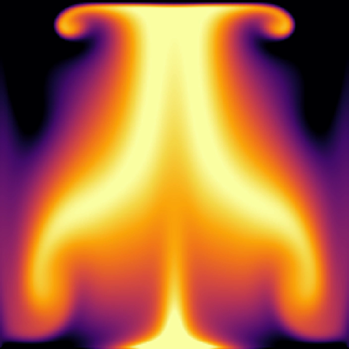
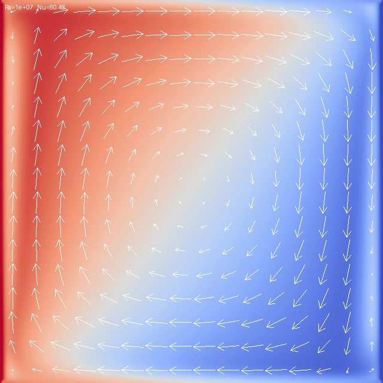
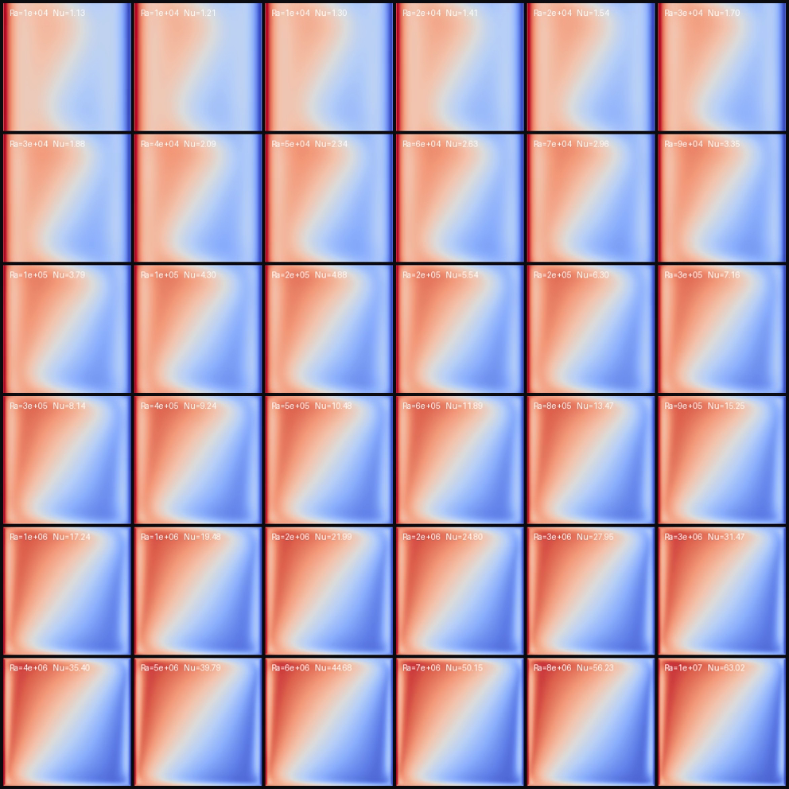
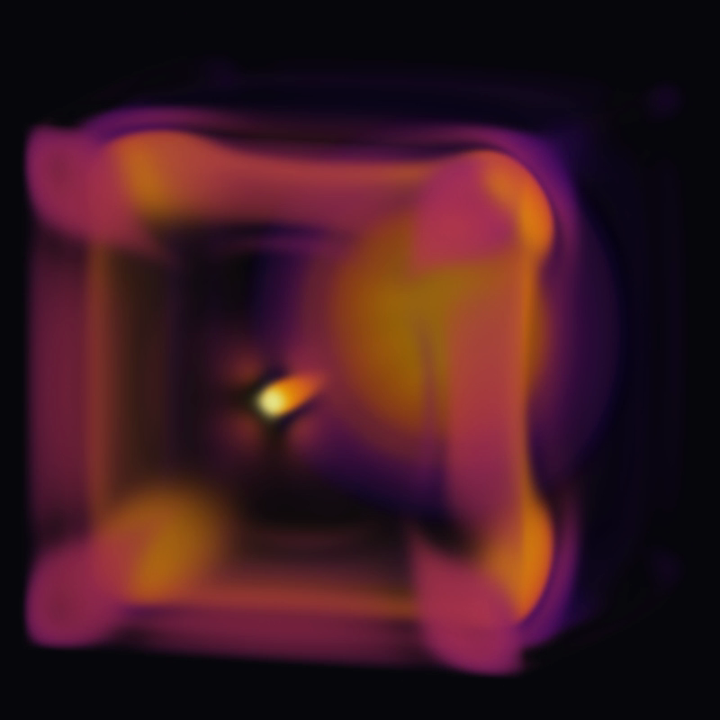
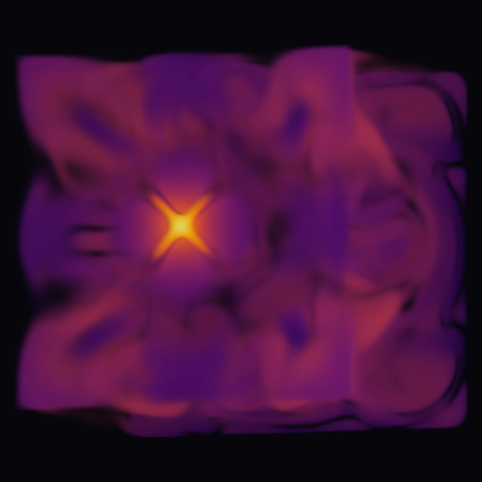
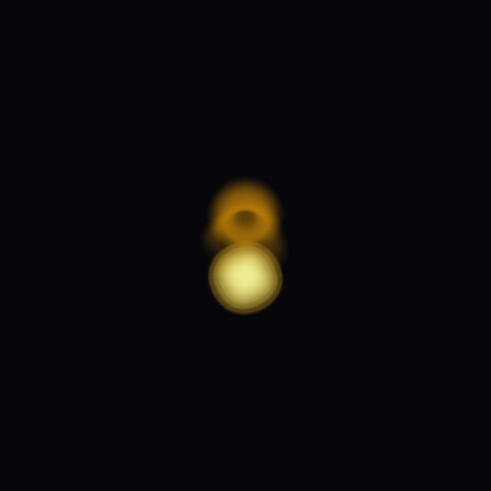
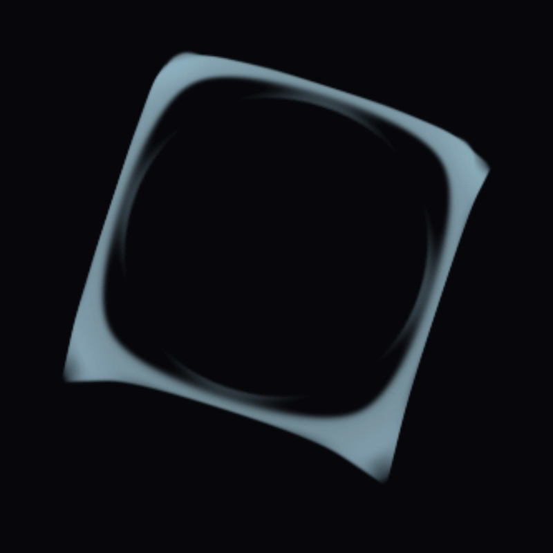
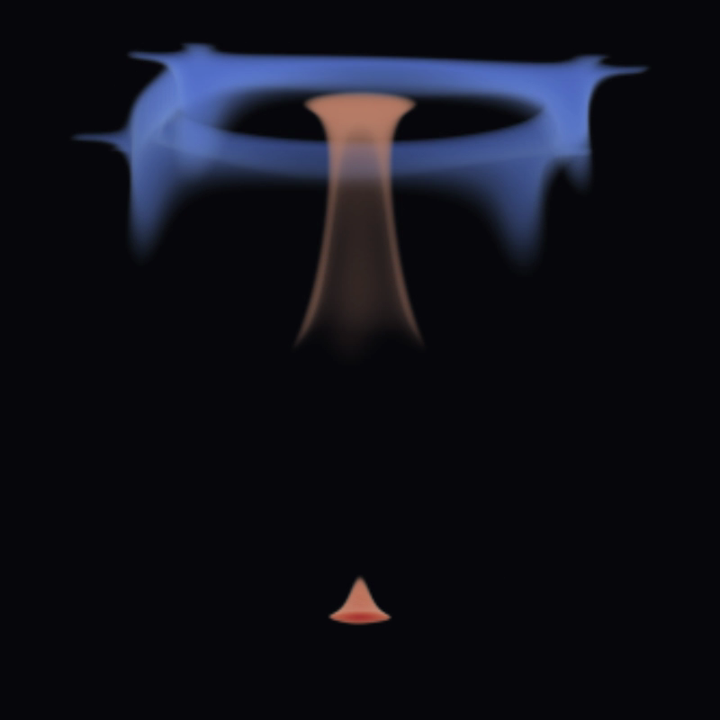
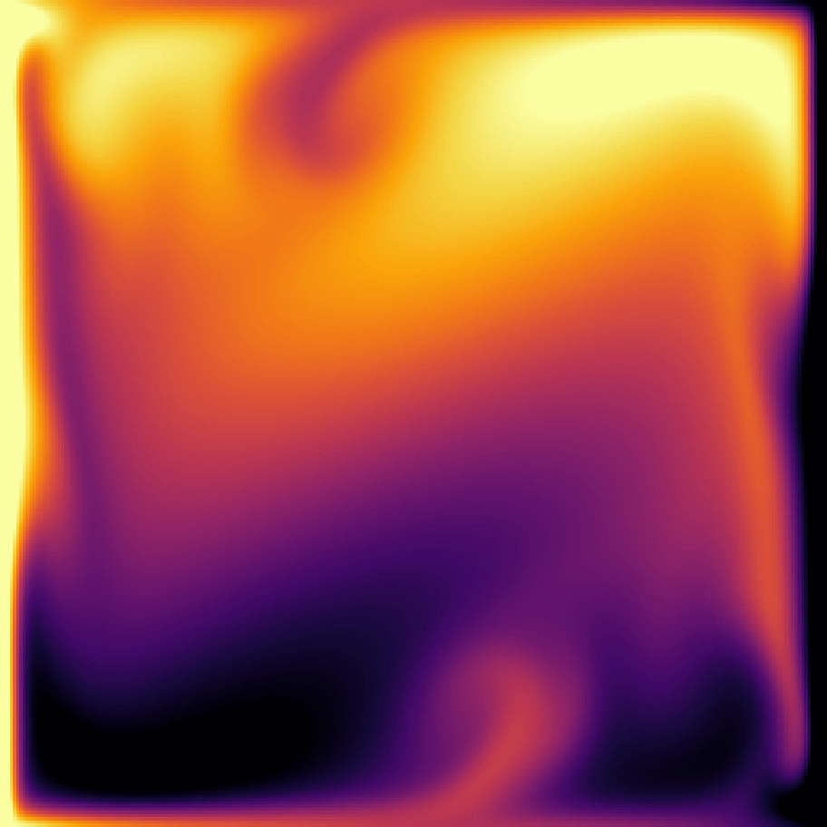
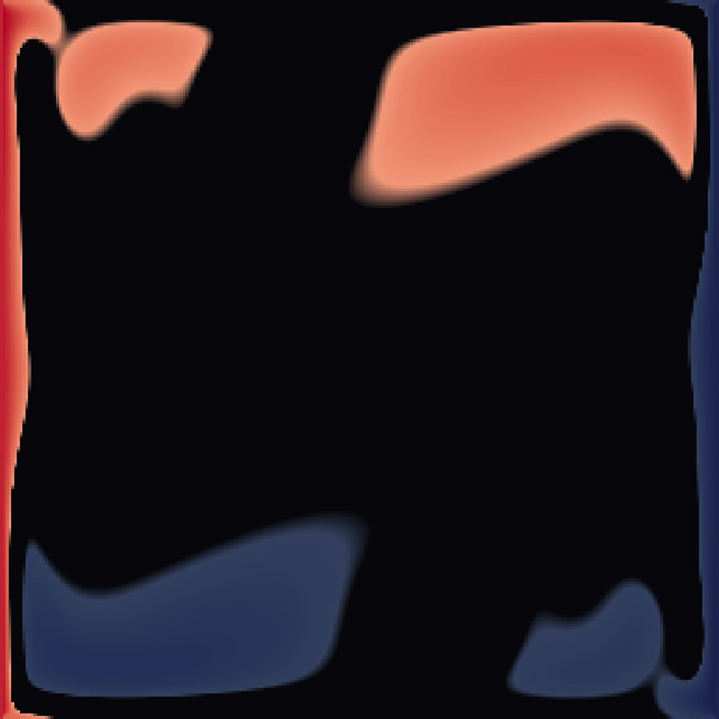

# CFDs with Dragon and Claude

> **Note**: The example in this post was inspired by a paper I worked on in
> graduate school with other members of my group and my boss, Judith Brown, at
> the University of Iowa in the Advanced Research Computing Services. The paper
> was published in Siggraph Computer Graphics, Volume 29 Number 2, May 1995. The
> paper was about visualizing data and used a room with a heated wall to model
> air convection within a room.

<a href="images/rb256_slice.mp4"></a>

This post focuses on using Dragon and Claude Opus 5 in the development of a CFD
solver. Dragon provides the foundational support for running both variants of
the solver described in this post. What's possibly more important, is that
Claude Opus 5 wrote all of the code for this blog post, including Dragon code,
under my direction. AI agents have gotten very good at writing Dragon code
(which is Python in this case). Using Claude, I was able to optimize the two
programs to my individual hardware. I ran it on a two-node Mac OS cluster as a
test of the Dragon multi-node support for Mac OS. The fact that Claude can write
and optimize Dragon code is likely the most interesting part of the project
along with the development style, basically teaching an AI agent, to do what you
want by prompting it along the way. The rest of the blog post goes into details
of the experiment and compares the performance and provides the results of the
two CFD implementations.

While Claude worked great to write the code with the direction I provided, if I
made the scope of my requests a little to wide (which I did at times to test
it), Claude made dumb mistakes too. Without proper guidance, AI agents will make
bold, assertive claims about what they have done, even when they are completely
wrong. In this blog post, two implementations were created using different
approaches that produce the exact same results and visualizations of the final
output were created that visually confirm realistic and proper results.

Computational Fluid Dynamics is a class of problems that have similar needs
while solving. They are simulations that are divided into a grid and require
information from neighboring grids to compute values at grid boundaries. One
instance of a CFD is a thermal convection simulation where air current is
modeled within some area. Thermal convection simulations that run on one laptop
or a cluster with the same code, and render themselves to video are demonstrated
here. This was built to find out what Dragon actually does for a scientific
workflow that is not tensor-shaped. BUT, by using Dragon, you would be all set
to combine simulation and AI inference which is one of the more recent
directions for both CFDs and AI simulation. Dragon makes it easy to combine the
two.

Typically CFDs computations use MPI (i.e. Message Passing Interface) which is a
well-known standard for writing CFD solvers. Ranks (i.e. processes - though
technically a rank is an MPI term to identify work to be done in parallel within
the MPI program) are each given a grid component or cell. When neighboring
values are needed to complete the computation of a time step in a simulation,
the rank will send its results to neighbors and receive the neighbor results it
needs to complete its work. MPI provides its own communication primitives for
communicating with ranks computing its neighbor cells. MPI communication
primitives work both on-node, and off-node when the problem is big enough to
spread across more than one node on a cluster or super computer.

High-performance MPI programming is available on its own, but also can be
started by Dragon. In other words, MPI programs can be started inside the Dragon
run-time and use all that Dragon offers including all the higher-level
communication and synchronization constructs supplied by Dragon. In addition,
Dragon can start multiple MPI programs at the same time on the same nodes, which
would be tricky to do without Dragon. Dragon enables ensembles of MPI programs
to run at the same time.

Dragon also has its own interprocess communication constructs and one such
construct is the Dragon Distributed Dictionary (i.e. DDict). The DDict is a
key-value store capable of being used not only between processes in a parallel
application, but between nodes. The DDict can be used to exchange neighbor
information between grid cells both on-node and off-node as an alternative to
using MPI primitives. Dragon makes it possible to create as many DDicts as you
have room for in your parallel application.

As a case study, the code in this directory implements two CFD solvers which do
an identical simulation across two nodes.

1. A traditional CFD solver using MPI and specifically the Python library
   mpi4py. This solver is started within Dragon. The code begins in the file
   halo3d_mpi.py
2. A second implementation that uses only Dragon and the DDict with no MPI code.
   In this implementation checkpointing is used within the DDict at each
   timestep to provide a simple API for computing results across timesteps. The
   Dragon only version, without MPI, is in the file halo3d.py

This directory carries the two solvers among other variations, the renderers,
the rendered output in [`images/`](images), and a head-to-head comparison of the
two halo-exchange transports: Dragon's Distributed Dictionary and MPI. The
output from the two solvers is identical and deterministic. Exactly the same
result is achieved by either solver.

## Conclusion

The details of the experiment and a visualization gallery are provided below.
The TL;DR conclusion is that AI doesn't replace programmers, but it certainly
revolutionizes the way we can work. I have never written a CFD before and can't
say I did in this blog post. That part of the work was done by Claude. However,
I was able to frame the problem for Claude and tell it what I was looking for
both as a CFD solver and in its use of Dragon. Claude was a great tool in
generating a few concrete examples that hopefully help others get started using
Dragon as a foundational layer for their own applications.

Not mentioned elsewhere is that while this application was optimized to run on a
particular set of hardware, the only thing that optimizes it is the use of
Policy objects when placing processes/ranks and the data shared between ranks.
Without those policies, the same code would run on a laptop (just at smaller
scale) or supercomputer (probably at larger scale). Dragon provides a
transparent foundation which makes it possible to move an application from one
platform to another with no rewriting. It's only when you get to optimizing it
for a particular platform that you may want to specialize your code for a
particular platform. The code presented here is specialized in that way to
demonstrate the use of Policy in Dragon code. No other multi-node, foundational
layers have the kind of portability and scalability that Dragon offers. Dragon
is THE platform that preserves your investment in writing a scalable, multi-node
application since it means the scale at which you run your application can grow
without needing a total rewrite. Other frameworks are not as portable, require
complex setup, and/or don't scale well at all. Dragon is the solution to all
these problems since it was designed from the start to be portable, simple to
install, and scalable.

One more thing to point out before all the details below. The code for this blog
post is written in Python. But Dragon also supports running C++ clients using
MPI and the DDict as well. Dragon can run Python code or C++ code with equal
ease. So if you have C++ code and have a need for a distributed key/value store
or want to run an C++ MPI application, Dragon has that covered.

Finally, I'll mention that Dragon is already being used at national labs in
scientific applications, in commercial libraries like NVidia's CuPhoton library,
and a wide range of other active projects including areas like AI assisted
biology. Dragon has been around for more than 7 years, is an actively developed,
free to use, open source project, and has many users. We would love to hear
about your Dragon success story and even help you with expert advice. Don't
hesitate to check out [dragonhpc.org](http://dragonhpc.org) where you can look
up contact information and read our docs. If you would like to join our
DragonHPC slack workspace, let us know and we can get you added.

## The Hardware

Everything below is measured on a two-node cluster of Macs:

| node | cores | memory |
|---|---|---|
| studio | 28 logical / 20 performance | 96 GB |
| max | 16 logical / 12 performance | 48 GB |

The two are joined by a **Thunderbolt bridge** — `bridge0`, 10.10.10.1 and
10.10.10.2, MTU 9000 — measured at **37.47 Gbit/s** on a single TCP stream, 94%
of the TB4 link rate. Dragon-level point-to-point latency is ~259 µs.

## What is here

| file | what it does |
|---|---|
| [`lbm.py`](lbm.py) | 2D thermal lattice Boltzmann solver, D2Q9 flow + D2Q5 temperature |
| [`lbm3d.py`](lbm3d.py) | 3D version, D3Q19 + D3Q7, side-heated or heated-floor |
| [`render.py`](render.py) | color mapping, montage, mp4 encoding (numpy + Pillow only) |
| [`vol3d.py`](vol3d.py) | oblique volume rendering with high-pass opacity |
| [`sweep.py`](sweep.py) | **ensemble**: many independent simulations, `mp.Pool` + DDict status |
| [`halo.py`](halo.py) | **decomposed 2D**: one domain split across ranks, DDict halo exchange |
| [`halo2.py`](halo2.py) | same, with explicit rank placement via `ProcessGroup` + `Policy` |
| [`halo3.py`](halo3.py) | same, with node-local DDicts routing the halo traffic |
| [`halo3d.py`](halo3d.py) | decomposed 3D solver, DDict exchange — the one that scales |
| [`halo3dv2.py`](halo3dv2.py) | slight variation of halo3d.py. Elininates one DDict. No appreciable performance difference. |
| [`halo3d_mpi.py`](halo3d_mpi.py) | **same solver, MPI exchange** — Dragon launches, `MPI_Sendrecv` moves the halos |
| [`probe.py`](probe.py) | measures DDict exchange latency with no simulation attached |
| [`scripts/`](scripts) | run harnesses: scaling matrices and the long production jobs |
| [`images/`](images) | rendered movies and verification stills |

The solver is validated, not decorative. At Ra=10⁴, n=64, run to steady state it
gives Nu = 2.2324 against the de Vahl Davis (1983) benchmark value of 2.2430 —
**0.47%**. Ra=10⁵ at n=128 is within 0.97%.

## Running everything

Anything that uses Dragon is launched with `dragon`. Everything else is plain
Python.

> **`--network-prefix '^bridge'` is mandatory on every multi-node run if you
> wish to use Thunderbolt on Mac OS. When running over the normal network on
> Linux or Mac OS you don't need this argument.** The default interface regex
> matches every NIC on a Mac, and HSTA pairs transport agents **by index** into
> a per-node interface list whose order differs between machines. A default run
> once selected an unplugged adapter's link-local address on one node and the
> bridge on the other, started three agents, and left two of them pointed at
> unreachable peers. Twelve HSTA segfaults were traced to exactly that window;
> there have been none since the flag became standard. There is no environment
> variable for it — it must be on the command line every time.

The host list lives in a file called `hostfile`. If you wish to run this code
you must set up Dragon on your cluster first and create your own hostfile.
[Directions for setting up a cluster can be found
here.](https://github.com/DragonHPC/dragon-tutorials/blob/main/macoscluster/README.md#building-a-two-node-mac-os-hpc-cluster-with-dragon).
However, some of this code is optimized for my particular two node cluster. It
would need some Dragon Policy changes to make it run elsewhere.

### 2D solver, one process

```bash
python lbm.py --n 256 --ra 1e6 --steps 20000 --frames-dir frames --frame-every 200
python render.py frames --out cavity.mp4 --vectors 16
```

`--vectors` overlays velocity arrows at that cell stride. Arrows are scaled to a
quarter of `u_ref`, because measured peak speeds are only 14–24% of it. Result:
[`images/hero_vectors.mp4`](images/hero_vectors.mp4),
[`images/vectors4.mp4`](images/vectors4.mp4).

### 2D ensemble: many independent cavities

```bash
dragon sweep.py --tiles 36 --n 256 --steps 6000 --workers 20 --out sweep
dragon --hostfile hostfile --network-prefix '^bridge' sweep.py \
    --tiles 36 --n 256 --steps 6000 --workers 32 --out sweep
python render.py sweep --out sweep.mp4 --cols 6
```

Each tile is an independent Rayleigh number. `render.py` groups the per-tile
PNGs by timestep and drops any step missing a tile, so ffmpeg sees a constant
frame size. Result: [`images/sweep36.mp4`](images/sweep36.mp4).

### 2D decomposed: one cavity split across ranks

```bash
dragon halo.py  --ranks 16 --n 512 --ra 1e6 --steps 4000           # single DDict
dragon halo2.py --ranks 16 --n 512 --steps 4000 --placement block  # explicit placement
dragon halo3.py --ranks 16 --n 512 --steps 4000                    # node-local DDicts
dragon halo.py  --ranks 4 --n 128 --check                          # verify against serial
```

`--check` reruns the case serially and reports max|ΔT|.

### 3D solver, one process

```bash
python lbm3d.py --n 128 --ra 1e7 --config side --steps 20000 \
    --frames-dir frames3d --frame-every 200
python lbm3d.py --n 64 --ra 1e4 --check-2d        # compare against the 2D solver
```

`--config side` holds x=0 hot and x=n-1 cold. `--config rb` heats the floor and
cools the ceiling; add `--floor-profile bump` for a localized hot patch rather
than a uniformly heated floor.

### 3D decomposed — DDict exchange

```bash
dragon --hostfile hostfile --network-prefix '^bridge' halo3d.py \
    --ranks-per-host "studio=20,max=12" \
    --n 256 --ra 1e7 --steps 40000 --config side \
    --frames-dir out --frame-every 400
```

Ranks are split by hostname to match core counts. Each rank writes its own slab
every frame and the driver assembles them into `frame_*.npz` at the end, so an
interrupted run can still be assembled from whatever slabs survived.

### 3D decomposed — MPI exchange

Note that no command below invokes `mpirun`. **MPI** (Message Passing Interface)
is the communication library that moves the halo faces; **PMI** (Process
Management Interface, current version PMIx) is the separate protocol a launcher
uses to start the ranks and tell each one its rank number, the job size and how
to reach the others. `MPI_Init()` asks a process manager those questions, and
normally `mpirun` is what answers. Here Dragon answers them —
`ProcessGroup(restart=False, pmi=PMIBackend.PMIX)` stands up PMIx servers on
each node — so Dragon launches the job and MPI only carries the data.

```bash
export DYLD_FALLBACK_LIBRARY_PATH=/opt/homebrew/lib:${DYLD_FALLBACK_LIBRARY_PATH}

dragon --hostfile hostfile --network-prefix '^bridge' halo3d_mpi.py \
    --ranks 16 --n 128 --ra 1e7 --steps 4000 \
    --config rb --floor-profile bump --placement block
```

> **The export is not optional when running on Mac OS. If running on Linux you
> need to set LD_LIBRARY_PATH** Without it the ranks cannot load the Open MPI
> libraries, PMIx never completes, and the frontend dies with
> `RuntimeError: Runtime startup aborted while waiting for TAUp` — a message
> that points at the transport agent and gives no hint about MPI. One export on
> the frontend reaches every node and every rank: Local Services builds each
> child's environment from its own (`the_env = dict(os.environ)` then
> `.update(req_env)`), and Dragon *prepends* its own library directory rather
> than replacing the value.

Needs `mpi4py` built against the same MPI as the nodes:

```bash
MPICC=/opt/homebrew/bin/mpicc pip install --no-binary=mpi4py mpi4py
```

### Measuring the transport with no physics attached

```bash
dragon --hostfile hostfile --network-prefix '^bridge' probe.py \
    --ranks 16 --steps 2000 --halo-bytes 400000
```

### Rendering

```bash
# mid-plane slice: the clearest view, and the only one with nothing to tune
python vol3d.py out --slice y --size 900 --ramp inferno --out slice.mp4

# hot and cold extremes overlaid, everything between them dropped to background
python vol3d.py out --slice y --mode twosided --threshold-pct 88 --cold-pct 12 \
    --ramp coolwarm --out overlay.mp4

# volume render, camera orbiting the room with the floor staying down
python vol3d.py out --mode twosided --threshold-pct 99.5 --cold-pct 2 \
    --az 20 --el 8 --spin 3.6 --ramp coolwarm --out orbit.mp4

# a single frame, for tuning before committing to a hundred of them
python vol3d.py out --slice y --still --still-index 50 \
    --mode twosided --out check.png
```

Opacity modes: `highpass` (default, structure), `gradient`, `threshold` (one
cut, `--invert` for the cold side), `twosided` (both cuts at once, with
`--cold-alpha` holding the cold side back). `--threshold-pct` sets the cut per
frame at a percentile instead of a fixed temperature.

`--still-index` exists because tuning a transfer function on the last frame and
assuming it generalizes is how we produced three unusable movies.


# Dragon versus MPI, in one function

The project implements the **same decomposition, the same solver and the same
arithmetic** twice, differing only in how a halo face gets from one rank to its
neighbor. `halo3d_mpi.py` imports `Slab3D` directly from `halo3d.py`. The
physics is equivalent between the two versions.

That makes the two worker functions a controlled comparison of the two
programming models.

## `rank_worker` (halo3d.py) — DDict

```python
def rank_worker(shared, local_dicts, results, placement, rank, n_ranks, params, ...):
    host = placement[rank]
    slab = Slab3D(params, rank, n_ranks, dtype=np.dtype(dtype_name))

    # Choose WHICH dictionary each face travels through.
    left_d  = local_dicts[host] if placement[slab.left_nbr]  == host else shared
    right_d = local_dicts[host] if placement[slab.right_nbr] == host else shared
    for d in used:
        d.checkpoint_id = 0

    slab.collide()
    to_left, to_right = slab.faces()
    left_d[f"halo/{rank}/left"]   = to_left      # publish an initial halo
    right_d[f"halo/{rank}/right"] = to_right

    for k in range(steps):
        # The next two lines automatically block until the neighbor values
        # are available. This is what wait_for_keys buys us on DDict creation.
        from_left  = np.asarray(left_d[f"halo/{slab.left_nbr}/right"])
        from_right = np.asarray(right_d[f"halo/{slab.right_nbr}/left"])

        slab.fill_ghosts(from_left, from_right)
        slab.stream()
        slab.collide()

        # Calling checkpoint advances this client's version in all DDicts
        # that it uses. This operation is local to this rank only.
        for d in used:
            d.checkpoint()
        to_left, to_right = slab.faces()
        left_d[f"halo/{rank}/left"]   = to_left
        right_d[f"halo/{rank}/right"] = to_right
```

## `run_worker` (halo3d_mpi.py) — MPI

```python
def run_worker(args) -> None:
    MPI.Init()
    comm = MPI.COMM_WORLD
    rank, n_ranks = comm.Get_rank(), comm.Get_size()

    slab = Slab3D(make_params(args), rank, n_ranks, dtype=dtype)
    left_nbr, right_nbr = slab.left_nbr, slab.right_nbr

    slab.collide()
    from_left  = np.empty_like(to_right)          # preallocated landing buffers
    from_right = np.empty_like(to_left)

    for k in range(args.steps):
        to_left, to_right = slab.faces()
        comm.Sendrecv(to_right, dest=right_nbr, sendtag=0,
                      recvbuf=from_left,  source=left_nbr,  recvtag=0)
        comm.Sendrecv(to_left,  dest=left_nbr,  sendtag=1,
                      recvbuf=from_right, source=right_nbr, recvtag=1)

        slab.fill_ghosts(from_left, from_right)
        slab.stream()
        slab.collide()
```

## What the diff actually shows

Here are a few notes about the two implementations, comparing and contrasting
them.

### 1. Addressing: by name versus by rank

MPI names a **peer**: `dest=right_nbr`. The sender must know who consumes the
data, and the receiver must be alive and posting a matching receive.

Dragon names a **value**: `halo/{rank}/left`. The producer does not know or care
who reads it. Any process that can attach to the dictionary can, including one
that did not exist when the value was written. The halo is published, not sent.

### 2. Synchronization: explicit versus emergent

`Sendrecv` *is* the synchronization — it is a rendezvous between exactly two
ranks, and both must arrive at the same place before they proceed.

In the DDict version there is no barrier anywhere. With `wait_for_keys=True` a
read blocks until the neighbor has published *at the reader's checkpoint*, so
lockstep falls out of the data dependency, though each grid location needs its
neighbors value so synchronization of steps is implicity. Versioning becomes
explicit: `d.checkpoint()` every step. Like the MPI version, ranks and processes
are dependent on neighbor values. In the DDict case a client that fails to
advance keeps checkpoint id 0 while others move on and possibly fails later with
`DDICT_CHECKPOINT_RETIRED`. Since all clients both write and read data they
participate in moving the DDict working set ahead. In the more general case, the
size of the working set dictates how far ahead or behind a particular client may
get.

**NOTE: The timestep never appears in the key.** The same four keys are
rewritten every step; the checkpoint id supplies the version and the working set
holds the last few.

### 3. Data placement is a lever in one model and absent in the other

This is the sharpest difference, and it is the reason `halo3d.py` is fast.

```python
left_d = local_dicts[host] if placement[slab.left_nbr] == host else shared
```

The DDict implementation is optimized to use one of two DDicts between
neighbors. If the two neighbors are on the same node, then a local DDict is
chosen so that neighbor sharing goes through shared memory on-node with no
off-node communication necessary. If neighbors are cross-node, then the *shared*
DDict is chosen that is created to hold halos shared between nodes.

The DDict worker *chooses the dictionary* per face: the node-local,
single-manager dictionary for faces whose neighbor are on the same machine, or a
small shared one only for the inter-node block seams. That choice was worth
**1.4× at 16 ranks and 3.5× at 32** over routing everything through one
cluster-wide dictionary.

MPI has no equivalent decision to make. `Sendrecv` routes itself either on-node
or off-node. Less to tune, but also a less flexible programming model.

### 4. Lifetime: a value persists, a message does not

An MPI message exists only for the duration of the call. Both ends must be
present simultaneously.

A DDict value outlives the exchange. The working set retains recent checkpoints,
so a straggler still finds its neighbor's face waiting. Initial values are
written in before the loop for the initial condition. Then values are updated
after checkpointing. This allows for a degree of independence in reading and
writing neighbor values, though there is still an implicit synchronization
between ranks/processes in the DDict implementation (i.e. `wait_for_keys`
creates the implicit synchronization).

### 5. What can be passed to a worker

`rank_worker` is a **Python callable**. `ProcessTemplate` takes live objects —
the DDict handles, the placement list, a `Params3D` instance — and they arrive
as objects.

`run_worker` cannot be. A PMI job needs a real executable, so the template is
`target=sys.executable, args=[__file__, ...]` and **every parameter degrades to
a command-line string**, to be re-parsed and reconstructed on the far side. The
results dictionary travels as a serialized descriptor that the rank re-attaches:

```python
worker_args = ["--worker-dser", results.serialize(), "--n", str(args.n), ...]
...
results = DDict.attach(args.worker_dser)
```

### 6. Placement works the same in both

A PMI job is a single rank space, but it still accepts per-call policies, and
ranks are numbered in `add_process` order. Coalescing consecutive same-host
ranks into one call each reproduces the DDict version's block and cyclic layouts
exactly — verified, both report `faces: 14 node-local, 2 shared`.

```python
for host, count in runs:
    grp.add_process(nproc=count, template=ProcessTemplate(
        ..., policy=Policy(placement=Policy.Placement.HOST_NAME, host_name=host)))
```

### 7. What disappears in the MPI version

No `checkpoint_id`, no `working_set_size`, no `wait_for_keys`, no choice of
dictionary per face, and no initial publish. `Sendrecv` cannot deadlock, so the
two directions need no ordering — only distinct tags. The MPI worker is
materially shorter.

What it gains instead: an `MPI.Init()`/`MPI.Finalize()` lifecycle, a deferred
`mpi4py.rc.initialize = False` import dance, preallocated receive buffers, and a
hard dependency on a correctly configured MPI installation on every node — the
`DYLD_FALLBACK_LIBRARY_PATH` trap above.

# Performance: DDict versus MPI

Five alternating reps, identical parameters on both sides, cluster verified idle
immediately before **every** run. All ten runs exited rc=0.

Configuration: n=128 (2.10M cells), 4000 steps, Ra=10⁷, float32, 16 ranks, block
placement 8/8, 14 node-local faces and 2 shared.

**MLUPS** is Millions of Lattice Updates Per Second, the standard throughput
measure for lattice Boltzmann — `cells × steps ÷ wall ÷ 1e6`, exactly as both
solvers print it. The DDict median works out as 2.097M × 4000 ÷ 305.70 s ÷ 10⁶ =
27.44, or about 13.1 timesteps per second. It is the useful number here because
it normalizes across problem sizes: the 128³ and 256³ runs are not comparable on
wall time, and MLUPS is what makes the ~47 MLUPS memory-bandwidth ceiling
visible as a ceiling.

## Per-run

| rep | DDict wall | MPI wall | DDict MLUPS | MPI MLUPS | DDict exch% | MPI exch% |
|---|---|---|---|---|---|---|
| 1 | 305.8 | 320.0 | 27.44 | 26.21 | 38.4 | 46.2 |
| 2 | 305.7 | 318.1 | 27.44 | 26.37 | 38.4 | 38.7 |
| 3 | 305.3 | 318.7 | 27.47 | 26.32 | 38.3 | 36.9 |
| 4 | 305.7 | 313.2 | 27.44 | 26.78 | 38.4 | 43.9 |
| 5 | 305.9 | 314.1 | 27.42 | 26.70 | 38.5 | 40.6 |

## Summary

| metric | version | **median** | mean | min | max | spread |
|---|---|---|---|---|---|---|
| wall (s) | DDict | **305.70** | 305.68 | 305.30 | 305.90 | 0.20% |
| wall (s) | MPI | **318.10** | 316.82 | 313.20 | 320.00 | 2.14% |
| MLUPS | DDict | **27.44** | 27.44 | 27.42 | 27.47 | 0.18% |
| MLUPS | MPI | **26.37** | 26.48 | 26.21 | 26.78 | 2.16% |
| exchange % | DDict | **38.40** | 38.40 | 38.30 | 38.50 | 0.52% |
| exchange % | MPI | **40.60** | 41.26 | 36.90 | 46.20 | 22.91% |

**DDict is faster by 4.06% on median wall time**, and the two distributions do
not overlap: DDict's slowest run (305.9 s) finishes 7.3 s ahead of MPI's fastest
(313.2 s). With five runs each and a clean separation, this is a result rather
than noise.

DDict is also far more repeatable — 0.20% wall spread against 2.14%. MPI's
exchange share is the unstable quantity, ranging 36.9% to 46.2% while DDict sits
between 38.3% and 38.5%.

That said, 4% is a modest margin on a problem that is **memory-bandwidth bound**
with exchange under half the run. The honest reading is that Dragon's
distributed dictionary is *competitive with MPI* on a tightly-coupled
nearest-neighbor exchange — which is MPI's home ground — while also being the
model that does not require an MPI installation, a PMI launcher, or an
executable entry point.

## Correctness: bit-identical

Four captured final fields — DDict and MPI, two independent repetitions each —
compared element by element at 128³ float32 after 4000 steps:

```
r1_ddict   identical=True   max|dT| = 0.0
r1_mpi     identical=True   max|dT| = 0.0
r2_ddict   identical=True   max|dT| = 0.0
r2_mpi     identical=True   max|dT| = 0.0
```

Not "close" — every one of 2,097,152 cells matches exactly. Swapping the
transport changes how the face bytes travel, never their values.

# The two parallel shapes

The project deliberately implements the same physics two ways, because they
stress completely different things.

**Ensemble** (`sweep.py`). 36 independent cavities at different Rayleigh
numbers. No communication between workers. One `mp.Pool`, one `DDict` holding
live per-tile status that the driver polls and prints while the sweep runs.

**Decomposed** (`halo.py`, `halo3d.py`, `halo3d_mpi.py`). One cavity cut into
slabs across ranks. Every rank exchanges halo faces with its neighbors **every
timestep**.

Work done between communications differs by about four orders of magnitude: ~40
s per message for the ensemble, ~1 ms for the decomposed solver. That single
ratio explains nearly every result that follows.

## What Dragon provided

### `mp.set_start_method("dragon")`

The ensemble is ordinary `multiprocessing`. Going from one node to two is a
launch flag, not a rewrite:

```bash
dragon sweep.py                                                  # single node
dragon --hostfile hostfile --network-prefix '^bridge' sweep.py   # both nodes
```

`mp.Pool.starmap_async` distributes whole simulations across every core on every
node. Measured on 36 tiles at n=256:

```
1 node (20 workers)   359.7s
2 nodes (32 workers)  219.9s      1.64x
```

Reproducible to under 1%, zero frames lost across four runs.

### DDict as a live status store

Workers write `status[f"tile/{id}"] = {...}` as frames are produced; the driver
reads the same keys to print progress. It stores arbitrary Python objects, so
the value is just a dict with floats and counters — no serialization layer, no
schema.

### `ProcessGroup`, `ProcessTemplate` and `Policy`

Explicit placement of ranks on named hosts:

```python
grp.add_process(nproc=1, template=ProcessTemplate(
    target=rank_worker, args=(...),
    policy=Policy(placement=Policy.Placement.HOST_NAME, host_name=host)))
```

Used for a weighted split that matches the hardware — `studio=20,max=12` rather
than an even 16/16. Because the halo exchange is lockstep, oversubscribing the
smaller node would gate *every* rank. Matching ranks to cores was worth 19%.
Dragon's Policy class gives you the control you need for this kind of optimized
placement.

### DDict manager placement

A DDict's managers can be pinned to a node:

```python
DDict(None, None, mem, managers_per_policy=1,
      policy=[Policy(placement=Policy.Placement.HOST_NAME, host_name=host)])
```

This turned out to matter far more than rank placement — see below.

## Results, including the ones that did not go our way

### Rank placement barely helped. Data placement was decisive.

With a 1D decomposition, round-robin placement makes *every* internal boundary
cross the network. Block placement leaves only the block seams. At 16 ranks that
is 16 remote faces versus 2 — an 8× reduction.

It bought nothing:

| ranks | block | cyclic |
|---|---|---|
| 8 | 39.3s | 38.4s |
| 16 | 34.6s | 32.2s |
| 32 | 99.5s | 119.6s |

The reason is that **rank placement does not decide where a key lives.** A DDict
spread over two nodes hashes keys to managers on both, so roughly half of every
rank's halos crossed the network regardless of where the rank ran.

Giving each node its own single-manager DDict for the faces that stay local, and
a small shared one for the seams, *did* work:

| | 16 ranks | 32 ranks |
|---|---|---|
| one cluster-wide DDict | 34.6s | 99.5s |
| node-local + shared | **22.9s** | **28.5s** |

1.4× at 16 ranks, 3.5× at 32.

> **Pre-bridge measurements.** Both tables above, and the 2D two-node table
> below, were taken over the office LAN and before `--network-prefix` was
> introduced, so some of them likely ran over a mis-selected NIC. The *ratios*
> between configurations held up on re-measurement; the absolute times did not.
> On the Thunderbolt bridge the node-local + shared configuration at 16 ranks
> measures **20.3–20.7 s** rather than 22.9 s.

A later controlled comparison isolated the bridge's contribution at 16 ranks: TB
bridge 20.3 s against anchored-LAN 22.9 s, **11.4% faster**, with exchange time
falling 13.1 s → 10.1 s (−23%) and compute unchanged. Adding a *second* cable
gave nothing (20.4 s vs 20.7 s, inside noise) — the halo is 8 KB per rank per
step, so it is round-trip bound, not bandwidth bound.

### In 2D, the second node made things worse

| | 1 node | 2 nodes |
|---|---|---|
| 8 ranks | 32.4s | 37.9s |
| 16 ranks | **20.6s** | 30.9s |
| 32 ranks | — | 116.5s (96% exchange) |

`probe.py` measures why: a halo exchange costs **412 µs within a node and 1609
µs across** — 4×. With a barrier every timestep, that dominates. (Pre-bridge.)

### The kernel is memory-bandwidth bound, and that is not Dragon's fault

Running K independent `python lbm.py` processes — no Dragon, no communication:

| K | per-process MLUPS | aggregate |
|---|---|---|
| 1 | 9.76 | 9.76 |
| 4 | 6.89 | 27.6 |
| 8 | 5.39 | 43.2 |
| 16 | 2.96 | 47.3 |

Aggregate saturates near 47 MLUPS no matter how many processes. Lattice
Boltzmann is a classic bandwidth-bound stencil.

This reframes the problem: **adding a node adds memory bandwidth, which this
kernel is starved of, and adds latency, which lockstep cannot hide.** The
ensemble collects the bandwidth and pays no latency. The decomposed 2D solver
collects the same bandwidth but pays 1.6 ms per step.

It is also why the DDict-versus-MPI margin above is only 4%: at 27 MLUPS the
machine, not the transport, is the binding constraint.

Essentially what this shows is that the problem needs to be big enough to need
more than one node and have enough parallelism to make it possible to overcome
the inter-node latency with the additional parallel computation advantage. If
the problem is too sequential, adding a second node does not help.

### In 3D, the second node wins

The 2D problem fit comfortably on one machine, so distribution was optional and
the latency was pure overhead. 3D is big enough that it pays to distribute over
multiple nodes and the inter-node latency is acceptable given the increase in
parallelism.

at 128³, 400 steps

| configuration | throughput |
|---|---|
| serial (`lbm3d.py`) | 3.80 MLUPS |
| 1 node, 16 ranks | 19.73 |
| 1 node, 20 ranks | 19.72 (bandwidth ceiling) |
| 2 nodes, 16 ranks (8/8) | 21.63 |
| 2 nodes, 32 ranks (20/12) | **25.71** |

**5.2× on one node, 6.8× on two.** The plateau between 16 and 20 ranks on a
single node is the same bandwidth wall; the second node's memory system is what
breaks through it.

At 256³ the measured figure is 23.75 MLUPS with the exchange share down from 38%
to 21% — better communication ratio, slightly worse throughput, because the
larger per-rank working set costs more in bandwidth than the ratio wins back.

A full 256³ production run held **24.4 MLUPS across 40,000 steps and 7h 40m**,
with no drift and no non-finite values. Short 400-step benchmarks predicted it
well (19.73 → 20.20 at 128³, 23.75 → 24.4 at 256³), which makes the probe a
trustworthy planning tool on this hardware.

### Two geometries, one decomposed solver

`halo3d.py` runs both. The heated-floor case (`--config rb --floor-profile
bump`) drives a plume up through the interior — [`images/rb256_movie.mp4`](images/rb256_movie.mp4),
[`images/rb256_slice.mp4`](images/rb256_slice.mp4). The side-heated case
(`--config side`) produces the classic boundary-layer circulation: fluid rises
on the hot wall, crosses beneath the ceiling, descends on the cold wall and
returns along the floor, leaving a diagonally stratified core —
[`images/wall256_slice.mp4`](images/wall256_slice.mp4),
[`images/rb256_side_orbit.mp4`](images/rb256_side_orbit.mp4).

The second geometry was not free. The heated walls sit on the *decomposition
axis*, so only the two end ranks carry them, and the flag was accepted long
before it did anything — `--config side` silently ran a heated-floor simulation
under a misleading name. After the fix, 1 rank versus 4 gives max|ΔT| =
0.000e+00 with the walls holding +0.497 and −0.497.

Their temperature distributions are nothing alike, which matters downstream:

| | median | p1 | p99 |
|---|---|---|---|
| heated floor | −0.119 | −0.414 | +0.008 |
| side-heated | 0.000 | −0.328 | +0.328 |

The heated floor is a cold bulk with a thin hot plume; the side-heated room is
symmetric. Rendering settings do not carry across — the cuts that isolate a
plume in one produce a lopsided, half-empty picture in the other.

## Things Worth Knowing

**`with DDict(...)` and `destroy()`.** A DDict that is never destroyed leaves a
`ddict_orc_*` file behind; Clients that use a DDict don't destroy it. That
should be done once, usually by the creator process that uses the DDict.

**Checkpoint retirement catches non-participants.** A client that never calls
`checkpoint()` on a dictionary keeps its id at 0 while others advance. Its next
put may fail with `DDICT_CHECKPOINT_RETIRED`. We hit this when ranks with no
seam face wrote their results to the checkpointed shared dict.

**NFS uid mapping.** The share maps one user to another on the second node, so
output directories need to be writable by the remote uid, and the *driver*
itself may be placed on the node that cannot chmod them. Deleting and recreating
a directory path leaves the other node holding a stale NFS handle. Source copied
into the share must be `chmod 644` — a 0600 file gives remote ranks
`[Errno 13] Permission denied`.

**The runtime can hang after the work is finished.** On both long runs, the user
program completed everything — frames assembled, scratch slabs deleted, `main()`
returned — and the Dragon runtime then failed to exit. `SIGTERM` to the launcher
is ignored; `SIGKILL` releases it and the data is intact. Anything waiting on
the run script should key off the output it expects rather than process exit.

**Buffered stdout can disappear.** The user program's output is block-buffered
into the log and is lost if the launcher is killed, so the closing throughput
line may never arrive. Reconstruct timings from file timestamps.

**Without `-l`, Dragon writes no actor logs at all.** A failing run gives you
exactly `Abnormal Exit detected` and nothing else. `-l actor_file=DEBUG` is what
produced the `TAUp` traceback that finally identified the MPI library-path
problem. Reach for it on the *first* failure, not the sixth.

## Open and unresolved

- **The 3D solver's Nusselt number sits ~5% below the validated 2D solver** in
  the 2D limit. The velocity fields agree to 4e-04, so the flow is right and the
  visuals are sound, but three hypotheses for the thermal discrepancy failed
  under test. Do not quote a Nusselt number from the 3D solver.
- **An intermittent two-node startup hang**, roughly 2–5% of launches. The
  signature is the frontend waiting on `TAUp` while one node has no
  `dragon-hsta` at all. Two contributing causes have since been identified and
  removed — mis-paired transport agents from a loose `--network-prefix`, and the
  missing MPI library path — but a residual rate remains that neither explains.
- 2D imagery at Ra=10⁸ is spectacular and physically wrong (Nu ≈ 200–500 where
  ~25–30 is expected). Visuals only.

## Visualization

Rendering is numpy + Pillow with a hand-built lookup table; no matplotlib,
because every worker would pay its import cost to do a color map. Video uses
imageio's bundled ffmpeg, so there is no system dependency.

The 3D renderer composites an oblique view by rotating the volume with
`scipy.ndimage.map_coordinates` and compositing front to back. Opacity is keyed
to a **high-pass** of the temperature field, not to temperature itself: a
convecting box is smooth and fills the volume, so compositing temperature
directly produces uniform fog. Removing the smooth background leaves plumes and
boundary layers hanging in clear space.

One finding worth repeating: a side-heated cavity at Ra=10⁶ is steady and
laminar, and *all* of its structure is in two thin wall boundary layers. There
is nothing inside the room to look at, and no transfer function can invent it.
At Ra=10⁷ the wall jets develop lobes and shed blobs, which a slice shows well.
Heating the floor instead — with a localized hot patch rather than a uniform one
— produces a plume that rises through the interior, which is what makes an
oblique volume rendering worth doing at all.

Transfer functions were the hardest part of the project, and their failures are
invisible from outside the file. Three movies passed every cheap check — correct
size, correct frame count, process exited zero — and were unusable on
inspection. A fixed temperature cut became a glowing cube halfway through a run,
because the room's mean temperature drifts and a cut that isolates a plume at
the end sits below the bulk earlier on. A diverging color map washed the plume
to white once the drifting cut landed on the map's pale midpoint. A cold-side
cut rendered the two cold walls rather than the return flow. All three were
caught by decoding frames back out of the encoded mp4 and looking at them, which
is now the standard check — the `chk_*_{10,50,99}.png` stills in
[`images/`](images) are exactly that: three time samples decoded back out of
each movie.

The camera was wrong for most of the project. Azimuth and elevation rotated
about the wrong axes, so "orbiting" the room tumbled it end over end — a quarter
of the way round, the camera was looking straight at the ceiling. It survived
because it was only ever checked at one or two angles on a compact structure,
where a tumble reads as foreshortening. Verification has to vary the same axis
the output does: three *time* samples of a rotating movie say almost nothing
about rotation, while four azimuths found it in under a minute.

A plane through the room needs none of this. `--slice` composites nothing, so
nothing can hide. A plume stem a few cells across is sharp in a slice and nearly
invisible in a volume render, because a thin feature accumulates almost no
opacity along a view ray. For reading the physics the slice is strictly better;
the volume renders exist to show that the flow is three-dimensional.

### Gallery

Each still below is a frame taken from the middle of the movie it links to —
**click the image to play it**. Captions name the program that produced the data
and the program that rendered it.

Commands marked **recovered** are the exact invocations, lifted from the scripts
that produced the file. Commands marked **recipe** are reconstructed from the
documented flags, because that output was produced interactively and the
original command line was not kept — they will give you the same *kind* of
picture, not a byte-identical one.

#### 2D cavity with velocity arrows

<a href="images/hero_vectors.mp4"></a>

`lbm.py` → `render.py`. 200 frames. Arrows are scaled to a quarter of `u_ref`,
because measured peak speeds are only 14–24% of it. **Recipe:**

```bash
python lbm.py --n 256 --ra 1e6 --steps 20000 --frames-dir frames --frame-every 100
python render.py frames --out hero_vectors.mp4 --vectors 16
```

[`vectors4.mp4`](images/vectors4.mp4) ([poster](images/poster_vectors4.png)) is
the same thing at a coarser arrow stride — `--vectors 4`, 30 frames.

#### The 36-tile Rayleigh-number ensemble

<a href="images/sweep36.mp4"></a>

`sweep.py` → `render.py`. 36 independent cavities, each at its own Rayleigh
number, no communication between workers. This is the ensemble shape — the one
that goes from one node to two by adding a launch flag. **Recipe:**

```bash
dragon --hostfile hostfile --network-prefix '^bridge' sweep.py \
    --tiles 36 --n 256 --steps 6000 --workers 32 --out sweep
python render.py sweep --out sweep36.mp4 --cols 6
```

#### Heated floor, volume rendered

<a href="images/rb256_movie.mp4"></a>

`halo3d.py` → `vol3d.py`, via
[`scripts/overnight3d.sh`](scripts/overnight3d.sh). 256³, 40,000 steps, a 7h 40m
production run that held 24.4 MLUPS throughout. **Recovered:**

```bash
dragon --hostfile hostfile --network-prefix '^bridge' halo3d.py \
    --ranks-per-host "studio=20,max=12" --n 256 --ra 1e7 --steps 40000 \
    --config rb --floor-profile bump --bump-width 0.3 \
    --frames-dir out --frame-every 400

python vol3d.py out --out rb256_movie.mp4 \
    --size 800 --gamma 2.5 --sigma 6 --density 0.5 --trim 5 \
    --az 35 --el 20 --spin 0.9 --ramp inferno --fps 12
```

[`rb128_movie.mp4`](images/rb128_movie.mp4)
([poster](images/poster_rb128_movie.png)) is the 128³ version.

#### Heated floor, mid-plane slice

<a href="images/rb256_slice.mp4"></a>

`halo3d.py` → `vol3d.py --slice`. The clearest view in the project and the only
one with nothing to tune: a slice composites nothing, so nothing can hide. A
plume stem a few cells across is sharp here and nearly invisible in a volume
render. **Recipe:**

```bash
python vol3d.py out --slice y --size 900 --ramp inferno --fps 12 --out rb256_slice.mp4
```

#### Heated floor, camera orbit

<a href="images/rb256_turntable.mp4"></a>

`halo3d.py` → `vol3d.py --turntable`, via `scripts/overnight3d.sh`. The camera
orbits a fixed field, so the floor stays down — this is the view that caught the
rotation bug, because varying azimuth is the only way to see an axis error.
**Recovered:**

```bash
python vol3d.py out --turntable 72 --out rb256_turntable.mp4 \
    --size 800 --gamma 2.5 --sigma 6 --density 0.5 --trim 5 --ramp inferno
```

Also [`rb128_turntable.mp4`](images/rb128_turntable.mp4)
([poster](images/poster_rb128_turntable.png)) and
[`rb_turntable.mp4`](images/rb_turntable.mp4)
([poster](images/poster_rb_turntable.png)), earlier and smaller.

#### Narrow-cut plume ("fountain")

<a href="images/rb256_fountain.mp4"></a>

`halo3d.py` → `vol3d.py`, via `perf/fountain.sh`. A hard threshold at 0.02 with
low density isolates the plume stem from the bulk. **Recovered:**

```bash
python vol3d.py "$DIR" --out rb256_fountain.mp4 \
    --mode threshold --threshold 0.02 --softness 0.02 --density 0.35 \
    --trim 2 --ramp inferno --size 800 --az 35 --el 18 --spin 0.9 --fps 12

python vol3d.py "$DIR" --turntable 72 --out rb256_fountain_turntable.mp4 \
    --mode threshold --threshold 0.02 --softness 0.02 --density 0.35 \
    --trim 2 --ramp inferno --size 800 --el 18 --fps 15
```

Turntable:
[`rb256_fountain_turntable.mp4`](images/rb256_fountain_turntable.mp4)
([poster](images/poster_rb256_fountain_turntable.png)).

#### Cold-side cut

<a href="images/rb256_cold.mp4"></a>

`halo3d.py` → `vol3d.py --invert`. Worth keeping as a cautionary example: on the
side-heated geometry the equivalent cut rendered the two cold *walls* rather
than the return flow, which is one of the three transfer functions that passed
every cheap check and was still unusable. **Recipe:**

```bash
python vol3d.py out --mode threshold --threshold-pct 12 --invert \
    --ramp coolwarm --size 800 --out rb256_cold.mp4
```

#### Side-heated geometry

<a href="images/rb256_side.mp4"></a>

`halo3d.py --config side` → `vol3d.py`. Hot wall at x=0, cold at x=n−1. The
classic boundary-layer circulation: fluid rises on the hot wall, crosses beneath
the ceiling, descends on the cold wall, returns along the floor, leaving a
diagonally stratified core.

Note that the heated walls sit on the *decomposition axis*, so only the two end
ranks carry them. **Recipe:**

```bash
dragon --hostfile hostfile --network-prefix '^bridge' halo3d.py \
    --ranks-per-host "studio=20,max=12" --n 256 --ra 1e7 --steps 40000 \
    --config side --frames-dir out_side --frame-every 400

python vol3d.py out_side --size 800 --ramp coolwarm --out rb256_side.mp4
```

Orbiting version: [`rb256_side_orbit.mp4`](images/rb256_side_orbit.mp4)
([poster](images/chk_rb256_side_orbit_50.png)).

#### Side-heated wall jets, slice

<a href="images/wall256_slice.mp4"></a>

`halo3d.py --config side` → `vol3d.py --slice`, via `perf/wall256_finish.sh`. At
Ra=10⁶ this geometry is steady and laminar and *all* of its structure is in two
thin wall boundary layers — there is nothing inside the room to look at, and no
transfer function can invent it. At Ra=10⁷ the wall jets develop lobes and shed
blobs, which is what this shows. **Recovered:**

```bash
python vol3d.py "$DIR" --slice y --size 900 --ramp inferno --fps 12 \
    --out wall256_slice.mp4
```

128³ version: [`wall128_slice.mp4`](images/wall128_slice.mp4)
([poster](images/chk_wall128_slice_50.png)).

#### Side-heated, two-sided hot/cold overlay

<a href="images/wall256_overlay.mp4"></a>

`halo3d.py --config side` → `vol3d.py --mode twosided`, via
`perf/wall256_finish.sh`. Both cuts at once, everything between them dropped to
background. The cuts are **per-frame percentiles**, not fixed temperatures —
that fix exists because a fixed cut became a glowing cube halfway through a run
as the room's mean temperature drifted. **Recovered:**

```bash
python vol3d.py "$DIR" --slice y --size 900 --mode twosided \
    --threshold-pct 88 --cold-pct 12 --softness 0.02 --ramp coolwarm --fps 12 \
    --out wall256_overlay.mp4
```

128³ version: [`wall128_overlay.mp4`](images/wall128_overlay.mp4)
([poster](images/chk_wall128_overlay_50.png)).

### Verification stills

The `chk_*_{10,50,99}.png` files are frames **decoded back out of the encoded
mp4** at 10%, 50% and 99% of its length. This is the standard check, and it
exists because three movies passed every cheap test — correct size, correct
frame count, exit code zero — and were unusable on inspection.

```bash
python vol3d.py out --slice y --still --still-index 50 --size 700 \
    --mode twosided --out chk_50.png
```

Sampling three points in *time* says almost nothing about a *rotating* movie,
though — four azimuths found the camera-axis bug in under a minute where three
time samples had missed it for weeks. Vary the same axis the output does.

The `poster_*.png` files are mid-movie frames extracted for this README and have
no diagnostic purpose.
